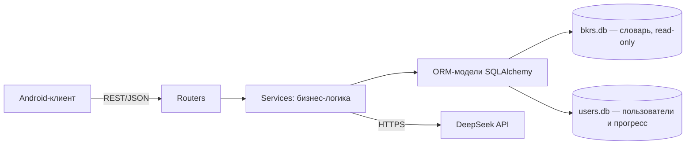
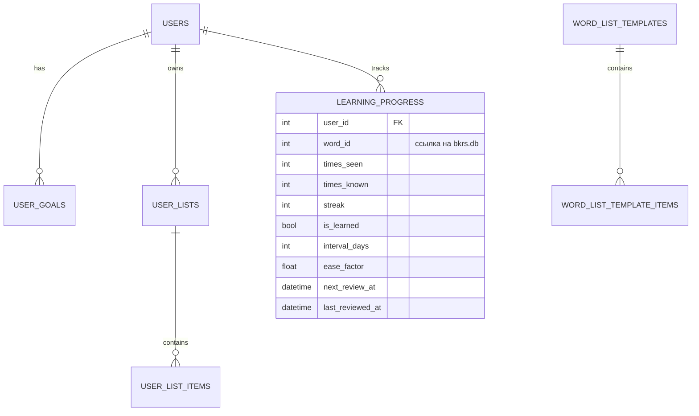

# Chinese Dictionary — Backend

REST API и слой данных для приложения-словаря китайского языка: поиск по словарю БКРС (3,4 млн статей), пользовательские списки, адаптивный HSK-тест, интервальное повторение SM-2 и ИИ-ассистент на DeepSeek.

> *Часть дипломного проекта. Клиент: [Chinese Dictionary (Android)](https://github.com/hopemask0/ChineseDictionary).*
> **EN:** FastAPI backend for a Chinese–Russian dictionary app: ETL of a 3.4M-entry DSL dictionary into SQLite, full-text-style search, spaced repetition (SM-2), adaptive placement test, and an LLM chat endpoint with vocabulary-constrained prompts.

---

## Что внутри

- **ETL словаря БКРС:** DSL → JSON → нормализация → SQLite (~1,2 ГБ, 3,4 млн статей)
- **Разметка по HSK 1–6**, на ней строятся тест, подборки и «слово дня»
- **Иероглифы:** 9 574 знака из Make Me a Hanzi (радикалы, число черт, данные написания)
- **Поиск** по иероглифам, пиньиню и переводу
- **Списки слов** пользователя и системные шаблоны (тематические, HSK)
- **Прогресс и SM-2:** интервал, коэффициент лёгкости и дата следующего повторения на каждое слово
- **Адаптивный HSK-тест:** вопросы и дистракторы генерируются из словаря
- **ИИ-чат:** серверный промпт ограничивает лексику выбранным списком + базовым HSK 1–2

## Стек

Python 3.12 · FastAPI · SQLAlchemy 2.0 · Pydantic v2 · SQLite (WAL) · Uvicorn · httpx

## Архитектура



```
api/
├── main.py            # приложение FastAPI, подключение роутеров
├── config.py          # настройки из .env
├── database.py        # подключения к двум БД, режим WAL
├── dependencies.py    # текущий пользователь
├── models*.py         # ORM-модели (словарь, пользователи, списки, прогресс)
├── schemas.py         # Pydantic-схемы запросов и ответов
├── routers/           # auth, search, words, characters, lists, progress, leveltest, chat
└── services/          # search, lists, progress (SM-2), leveltest, chat (DeepSeek)
scripts/
└── seed_hsk_lists.py  # создание системных HSK-шаблонов
```

## Модель данных

Две базы с разным жизненным циклом:

| База | Содержимое | Режим |
|---|---|---|
| `bkrs.db` | `words`, `meanings`, `examples`, `hanzi_characters` | только чтение, обновляется целиком |
| `users.db` | `users`, `user_goals`, `user_lists`, `user_list_items`, `word_list_templates`, `word_list_template_items`, `learning_progress` | чтение и запись |

Связь между базами — по `word_id` **без внешнего ключа** (сознательный компромисс: словарь можно заменить, не мигрируя пользовательские данные; целостность контролируется в коде).



## Алгоритм интервального повторения (SM-2)

| Ответ | `streak` | `ease_factor` | `interval_days` |
|---|---|---|---|
| «Знаю» | +1 | `min(2.5, EF + 0.1)` | 0 → 1 → 3 → `int(interval × EF)`, максимум 60 |
| «Учу» | 0 | `max(1.3, EF − 0.2)` | 0 (повторить сегодня) |

Слово считается выученным при `streak ≥ 3`. Следующий показ: `next_review_at = now + interval_days`.

## Быстрый старт

```bash
git clone https://github.com/<ВАШ_НИК>/<ИМЯ_BACKEND_РЕПО>.git
cd <ИМЯ_BACKEND_РЕПО>

python -m venv venv
# Windows: .\venv\Scripts\activate    Linux/macOS: source venv/bin/activate
pip install -r requirements.txt

cp .env.example .env        # впишите свой DEEPSEEK_API_KEY
uvicorn api.main:app --host 0.0.0.0 --port 8000 --reload
```

Документация API (Swagger UI): <http://localhost:8000/docs>

### Переменные окружения (`.env`)

| Переменная | Назначение |
|---|---|
| `DEEPSEEK_API_KEY` | ключ DeepSeek; без него чат отвечает 503, остальное работает |
| `DEEPSEEK_BASE_URL` | по умолчанию `https://api.deepseek.com` |
| `DEEPSEEK_MODEL` | по умолчанию `deepseek-chat` |

> Файл `.env` и базы `*.db` не хранятся в репозитории. Ключ API никогда не уходит на клиент: Android-приложение обращается только к этому серверу.

### Данные

Словарная база **не включена** в репозиторий (≈1,2 ГБ, а исходный словарь БКРС распространяется на условиях его авторов). Чтобы собрать её самостоятельно, запустите парсер на своём экземпляре словаря в формате DSL. Пользовательская база `users.db` создаётся автоматически при первом запуске. Системные HSK-шаблоны создаются командой:

```bash
python -m scripts.seed_hsk_lists
```

## Основные эндпоинты

| Метод | Путь | Назначение |
|---|---|---|
| GET | `/api/lists/catalog` | каталог системных шаблонов |
| GET | `/api/lists/my` | списки пользователя |
| GET | `/api/progress/stats` | статистика и SRS-метрики (`due_count`, `next_review_at`) |
| GET | `/api/progress/session/{list_id}` | карточки для тренировки |
| POST | `/api/progress/review` | записать ответ («знаю»/«учу»), пересчитать SM-2 |
| POST | `/api/chat/message` | сообщение ИИ-ассистенту (история приходит от клиента) |

Остальные маршруты (поиск, слова, иероглифы, тест уровня, авторизация) смотрите в Swagger UI.

## Проверка

Эндпоинты проверялись вручную через Swagger UI и сквозными сценариями из Android-клиента (успешные ответы, пустые данные, ошибки авторизации и внешнего сервиса). Частые находки при отладке: рассинхрон имён полей между ORM-моделью и реальной таблицей, блокировки SQLite (решено режимом WAL и таймаутом).

## Ограничения и план развития

- **Авторизация упрощённая:** пользователь определяется заголовком `X-User-Id`, пароля нет. Для продакшена нужны JWT и хеширование паролей.
- **SQLite** подходит для MVP (один писатель). Для нагрузки — PostgreSQL; доступ через ORM упрощает переход.
- **Миграции схемы** выполняются SQL-скриптами вручную; следующий шаг — Alembic.
- **Очистка переводов** (заголовки секций, пометы частей речи) частично делается при выдаче, а не при загрузке — её стоит перенести в ETL.
- Нет журнала ответов (`review_log`): хранится только текущее состояние прогресса, поэтому нет кривых забывания и когортной аналитики.
- Различение HSK 1 и HSK 2 пока грубое, частотный индекс слов не добавлен.

## Автор

Надежда — [GitHub](https://github.com/hopemask0) · контакты в профиле
